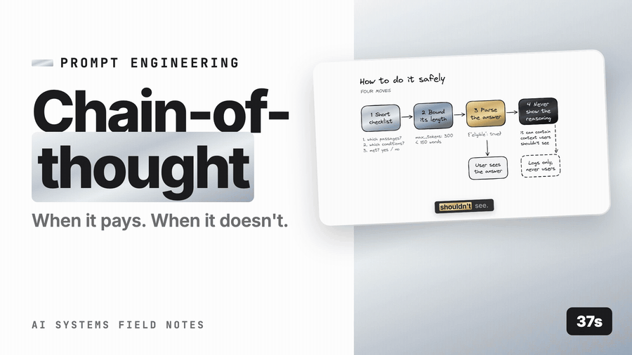

# Prompt engineering → Chain-of-thought (when it pays, when it doesn't)



*([full-resolution MP4 with audio](demo/chain-of-thought-demo.mp4) — 38s · [watch on YouTube](https://youtu.be/Ox4Wo9zqwbs))*

## What it is

Chain-of-thought (CoT) prompts the model to produce intermediate reasoning — "think step by step", or a structured `<thinking>` section — before the final answer. The reasoning tokens give the model "scratch space" to decompose the problem, check constraints, and avoid jumping to a plausible-looking wrong answer.

Modern **reasoning models** (Claude with extended thinking, o-series, etc.) do this natively with a controllable thinking budget; prompted CoT is the manual version for non-reasoning models or for controlling the structure of the reasoning.

Where it helps: multi-step arithmetic/logic, comparing options, planning agent steps, legal/policy reasoning with conditions, debugging, anything where the answer depends on intermediate conclusions.

Where it doesn't: single-label classification, entity extraction, simple lookups from provided context, format conversion. Here CoT adds tokens, latency, and sometimes *hurts* (the model talks itself out of the right answer).

## How to implement

1. **Decide per call site** ([model selection & tradeoffs](../../../04-llm-foundations/apply/model_selection.md)) based on the golden set: run with and without CoT; keep CoT only where accuracy improves enough to pay for the latency.
2. **Structure the reasoning**: `<thinking>…</thinking>` then `<answer>…</answer>`; or a numbered checklist the model must go through ("1. Which passages are relevant? 2. What conditions apply? 3. Answer."). Structured beats "think step by step" for reliability.
3. **Hide reasoning from users** — parse the answer block; log the reasoning for debugging (it's useful evidence in incident review).
4. **For reasoning models**: use the native thinking parameter with a budget; don't also prompt CoT (redundant); tune the budget per call site.
5. **Bound output tokens**: CoT can run long; set `max_tokens` and a "be concise in reasoning" instruction.
6. **Don't trust the reasoning as faithful**: the stated reasoning is not guaranteed to be the actual cause of the answer. Use it for debugging, not as a correctness proof — verify answers with checks ([faithfulness check](../../../06-rag/apply/8-generation-grounding/faithfulness_check.md)).
7. **Streaming**: stream the answer block only, or show a "thinking…" indicator; users shouldn't watch 400 tokens of deliberation.

## Small example

```python
SYSTEM = """Determine whether the employee is eligible for the requested leave under the policy passages provided.

Work through the checklist inside <thinking>, briefly:
1. Which passages define eligibility for this leave type?
2. Which conditions apply (tenure, hours, notice, documentation)?
3. Does the employee's situation satisfy each condition? (yes/no per condition)
Then give the decision inside <answer> as JSON: {"eligible": true|false|"unknown", "conditions_unmet": [...], "citations": [...]}.
Keep <thinking> under 150 words."""

def decide(passages, situation):
    r = llm("policy_decision", SYSTEM, [{"role": "user", "content": f"<context>{passages}</context>\n<situation>{situation}</situation>"}],
            max_tokens=700)
    text = r.content[0].text
    thinking = text.split("<thinking>")[1].split("</thinking>")[0] if "<thinking>" in text else ""
    answer = text.split("<answer>")[1].split("</answer>")[0]
    log_reasoning(thinking)               # for debugging; never shown to the user
    return json.loads(answer)

# Reasoning-model variant (Anthropic extended thinking): no CoT prompt, set a budget instead
# client.messages.create(model="claude-sonnet-5", thinking={"type": "enabled", "budget_tokens": 2000}, ...)
```

## Pros

- **Accuracy gains** on multi-step and conditional problems, often large.
- **Debuggable**: the reasoning shows *where* it went wrong.
- **Structured checklists** enforce procedure (relevant passages → conditions → decision), which also improves citation quality.
- Native thinking budgets let you trade cost for accuracy per call.

## Cons

- **Latency and cost**: 3–10× output tokens; time-to-answer grows.
- **No gain, sometimes loss**, on simple tasks.
- **Reasoning isn't always faithful** — plausible rationales for wrong answers.
- **Leakage risk**: reasoning can contain content you don't want shown (internal notes, other users' data from context); never render it.
- Long reasoning can drift off-task; needs bounds.

## When to use

- Policy/eligibility decisions with conditions; comparisons; planning and replanning in agents ([planning styles](../../../07-agents-tools-memory/apply/1-agents/planning_styles.md)); math; code; root-cause analysis; the critic/verifier role ([loop-back / reflection](../../../07-agents-tools-memory/apply/1-agents/loop_back_reflection.md)).
- Any call site where the golden set shows a clear CoT gain.

## When NOT to use

- Classification, extraction, rewriting, routing, simple grounded Q&A — measure, but expect no gain.
- Latency-critical paths (autocomplete, real-time routing).
- When the output is validated structurally anyway and errors are cheap to retry.

## Production at scale

**Per-call-site decision, measured.** Keep a table: call site, CoT on/off, accuracy, p95 latency, output tokens. Revisit on model upgrades — newer models often need less CoT.

**Budget the thinking.** For reasoning models, set `budget_tokens` per call site (small for routine, larger for hard); cap `max_tokens`. Monitor output tokens per call — a prompt regression that triggers verbose reasoning shows up as a cost spike.

**Escalation pairing.** CoT is a natural escalation step ([routing & escalation](../../../04-llm-foundations/apply/routing_escalation.md)): fast model without CoT → on low confidence, reasoning model with CoT.

**Streaming UX.** Show a thinking indicator; stream only the answer. Or stream the reasoning as a collapsible "how I got here" if your users value it — but never for consumer-facing systems where reasoning can mention other context.

**Logging and privacy.** Reasoning text is logged for debugging; it contains context content, so it falls under the same retention/PII rules as prompts ([data residency & retention](../../../10-production/apply/6-security-privacy-governance/data_residency_retention.md), [PII](../../../10-production/apply/6-security-privacy-governance/pii.md)).

**Evaluate the answer, not the reasoning.** LLM-judge ([LLM-as-judge](../../../09-evaluation/apply/llm_as_judge.md)) scoring on the final answer; reasoning review is for humans triaging failures ([feedback capture & triage](../../../10-production/apply/8-data-flywheel/feedback_capture_triage.md)).

**Agents**: CoT before each tool call improves tool selection; bound it (a paragraph, not an essay) or step latency balloons ([single agent loop](../../../07-agents-tools-memory/apply/1-agents/single_agent_loop.md)).

## Prod checklist

- [ ] CoT on/off decided per call site by golden-set A/B (accuracy vs latency/tokens)
- [ ] Structured thinking (checklist) with a word/token bound; answer block parsed separately
- [ ] Native thinking budgets for reasoning models; `max_tokens` capped
- [ ] Reasoning never rendered to users by default; logged under prompt retention rules
- [ ] Output-token dashboards per call site; alerts on spikes
- [ ] Re-evaluated on model upgrades

## Metrics to watch

| Metric | Why |
|---|---|
| Accuracy with vs without CoT per call site | Justification |
| Output tokens and p95 latency per call site | Cost/UX |
| Thinking-budget utilisation | Tuning |
| Answer-block parse failures | Structure adherence |

## Related

- [Model selection](../../../04-llm-foundations/apply/model_selection.md), [Routing/escalation](../../../04-llm-foundations/apply/routing_escalation.md)
- [Self-consistency](self_consistency.md) — CoT sampled n times
- [Reflection](../../../07-agents-tools-memory/apply/1-agents/loop_back_reflection.md), [Planning styles](../../../07-agents-tools-memory/apply/1-agents/planning_styles.md)
- [Faithfulness check](../../../06-rag/apply/8-generation-grounding/faithfulness_check.md) — verify answers, don't trust rationales
