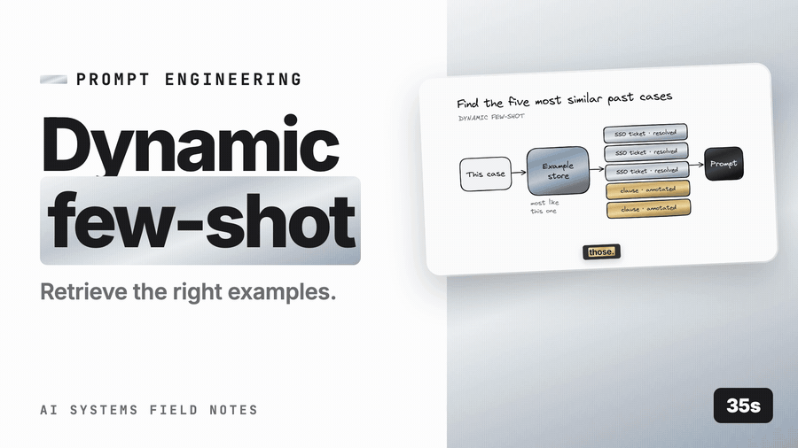

# Prompt engineering → Dynamic few-shot selection (retrieve the k most similar solved cases)



*([full-resolution MP4 with audio](demo/dynamic-few-shot-selection-demo.mp4) — 35s · [watch on YouTube](https://youtu.be/aqf7kMcLfUI))*

## What it is

Static few-shot ([zero-shot and few-shot prompting](zero_few_shot.md)) teaches format. Dynamic few-shot teaches *judgement*: for a support ticket about SSO redirects, show the model three previously resolved SSO tickets with their correct labels/replies; for a contract clause, show three similar clauses with their expert annotations. The examples come from an **example store** — a curated set of (input, ideal output) pairs — retrieved by similarity to the current input.

It's a small RAG system: the corpus is your labelled examples; the query is the current input; the retrieved "chunks" are examples; they go into the prompt as `<example>` blocks. Everything about embeddings, versioning, ACLs, and evals applies.

Where it shines: classification with many/fuzzy labels, extraction with domain conventions, style-matched generation (replies in the house voice for this product line), code generation against internal APIs, SQL generation over a specific schema (retrieve similar past queries).

## How to implement

1. **Build the example store**: high-quality (input, output) pairs from golden data, expert labels, and *accepted* production outputs (thumbs-up, human-edited finals). Each has `id, input, output, task, tags, tenant scope, quality score, created_at, version`.
2. **Embed the inputs** (query-side text) with the same embedder used at retrieval; store in a vector index namespaced by task (and tenant if examples are tenant-specific).
3. **At request time**: embed the input; retrieve top-k (k=3–8) with filters (task, tenant, language, label balance if classification); optionally rerank ([reranking](../../../06-rag/apply/6-retrieval-ranking/reranking.md)) and apply diversity ([MMR / diversity](../../../06-rag/apply/6-retrieval-ranking/mmr_diversity.md)) so the examples aren't near-duplicates of each other.
4. **Render** into the prompt after the stable instructions ([prompt structure](prompt_structure.md)) — they are dynamic content and won't cache; keep k small.
5. **Exclude the current item** (and near-duplicates of it) from its own examples when evaluating; otherwise you leak the answer.
6. **Fallback** to static examples when retrieval returns nothing above a similarity floor.
7. **Evaluate** dynamic vs static on the golden set ([prompt evaluation](../../../09-evaluation/apply/prompt_evaluation.md)) — with the golden items excluded from the store.

## Small example

```python
class ExampleStore:
    def __init__(self, vec, embed): self.vec, self.embed = vec, embed

    def add(self, ex):                     # ex: {id, task, tenant, input, output, quality, version}
        self.vec.upsert(ex["id"], self.embed(f"query: {ex['input']}"), payload={k: ex[k] for k in ("task", "tenant", "quality", "version")} | {"input": ex["input"], "output": ex["output"]})

    def similar(self, task, tenant, text, k=4, floor=0.55, exclude_ids=()):
        hits = self.vec.search(self.embed(f"query: {text}"), limit=k * 3,
                               filter={"task": task, "tenant": {"in": [tenant, "global"]}, "quality": {"gte": 0.8}})
        hits = [h for h in hits if h.score >= floor and h.id not in exclude_ids]
        return mmr(hits, k=k, lambda_=0.7)          # diverse, not five copies of the same case

def render_examples(exs):
    return "<examples>\n" + "\n".join(f"<example>\n<input>{e.payload['input']}</input>\n<output>{e.payload['output']}</output>\n</example>" for e in exs) + "\n</examples>"

def classify_dynamic(ticket, tenant):
    exs = store.similar("ticket_label", tenant, ticket, k=4) or STATIC_EXAMPLES
    prompt = f"{render_examples(exs)}\n\n<input>{ticket}</input>"
    r = llm("intent_classifier", CLASSIFY_SYS, [{"role": "user", "content": prompt}], max_tokens=5)
    return validate_label(r.text), [e.id for e in exs]      # log which examples were used
```

## Pros

- **Higher accuracy** on domain tasks than static examples; often comparable to light fine-tuning without training.
- **Improves continuously** as accepted outputs are added — a data flywheel ([data flywheel](../../../10-production/apply/8-data-flywheel/data_flywheel.md)) with no retraining.
- **Per-tenant adaptation** for free: tenant-scoped examples.
- **Explainable**: "we labelled it BILLING because these three similar tickets were BILLING".

## Cons

- **It's a RAG system**: embeddings, index, versioning, ACL, monitoring — real infrastructure.
- **Examples are dynamic tokens**: no prompt-cache benefit for them; cost per call rises with k.
- **Contamination risk**: a wrong "accepted" output gets retrieved and copied; quality control on the store is essential.
- **Leakage**: cross-tenant examples in the prompt = data leak; golden items in the store = inflated evals.
- Near-duplicate examples waste slots; needs diversity.
- Label imbalance in retrieved examples biases classification.

## When to use

- Domain classification/extraction with many or fuzzy categories.
- Style-matched or convention-heavy generation (replies, SQL over a schema, code against internal APIs).
- When you have (or can accumulate) hundreds+ of good solved cases.
- Multi-tenant systems where each tenant has its own conventions.

## When NOT to use

- Format-only needs — static examples suffice and cache.
- Fewer than ~50 quality examples — retrieval returns irrelevant cases; use static.
- Latency-critical paths where an extra embedding + search hop is unaffordable (cache by input hash if inputs repeat).
- When examples contain sensitive content that can't be scrubbed for prompt use.

## Production at scale

**Store quality is everything.** Only *curated* examples: golden labels, expert annotations, and production outputs that passed human review or strong implicit acceptance (edited-and-sent counts; thumbs-up alone is weak). Attach a `quality` score; retrieve above a threshold. Periodically re-audit; remove examples whose labels changed under a new taxonomy.

**Tenant scoping and privacy.** Examples are tenant data. Namespace by tenant; allow a curated `global` pool that has been scrubbed of PII and approved. Never let a tenant's example appear in another tenant's prompt ([authentication & authorization](../../../10-production/apply/6-security-privacy-governance/authn_authz_permission_filtered_retrieval.md), [PII](../../../10-production/apply/6-security-privacy-governance/pii.md)).

**Versioning.** Examples carry `task_version`/`taxonomy_version`; a taxonomy change invalidates examples with old labels. Embedding model change → re-embed the store ([versioning & migration](../../../06-rag/apply/3-embeddings/embedding_versioning.md)).

**Label balance.** For classification, retrieve top-k per label (or enforce at least one example per plausible label) to avoid biasing toward whichever label dominates the neighbourhood.

**Diversity.** MMR ([MMR / diversity](../../../06-rag/apply/6-retrieval-ranking/mmr_diversity.md)) over examples so the k slots cover different aspects; near-duplicate examples add nothing.

**Leakage controls in evals.** Exclude golden items and their near-duplicates from the store during evaluation; report dynamic vs static with that exclusion.

**Cost.** k=4 examples of ~150 tokens each = 600 dynamic tokens per call; at scale that's real. Cap k; trim long examples; use the fast tier for the call. Cache retrieval results by input hash for repeated inputs.

**Monitoring.** Log example IDs used per call. Track: retrieval floor misses (fallback rate), example usage distribution (a few examples dominating → store gaps), per-example "accuracy when used" (an example correlated with wrong outputs is bad — remove it).

**Flywheel.** Accepted outputs → review queue → store. Weekly cadence; measure golden-set movement after each store update ([data flywheel](../../../10-production/apply/8-data-flywheel/data_flywheel.md)).

## Prod checklist

- [ ] Curated example store with quality scores, task/taxonomy versions, tenant scope
- [ ] Task-namespaced vector index; same embedder as retrieval; re-embed on model change
- [ ] Similarity floor + static fallback; MMR diversity; label balance for classification
- [ ] Current item and near-duplicates excluded (evals); golden items excluded from store
- [ ] Tenant isolation; scrubbed global pool
- [ ] Example IDs logged per call; per-example accuracy tracked; bad examples removed
- [ ] k and example length capped; cost per call tracked
- [ ] Regular curation pipeline from accepted outputs

## Metrics to watch

| Metric | Why |
|---|---|
| Golden-set accuracy dynamic vs static (leak-free) | Value |
| Fallback (floor-miss) rate | Store coverage |
| Per-example accuracy-when-used | Contamination |
| Dynamic tokens per call | Cost |
| Store size and freshness per tenant/task | Flywheel health |

## Related

- [Zero/few-shot](zero_few_shot.md) — static baseline
- [Embeddings](../../../06-rag/apply/3-embeddings/) Embeddings, [MMR](../../../06-rag/apply/6-retrieval-ranking/mmr_diversity.md) — retrieval machinery reused
- [Data flywheel](../../../10-production/apply/8-data-flywheel/data_flywheel.md) — where examples come from
- [SFT](../../../08-choosing-the-lever/apply/fine-tuning/sft.md) — when the store outgrows the prompt
- [Authentication & authorization](../../../10-production/apply/6-security-privacy-governance/authn_authz_permission_filtered_retrieval.md) / [PII](../../../10-production/apply/6-security-privacy-governance/pii.md) — tenant isolation and PII
