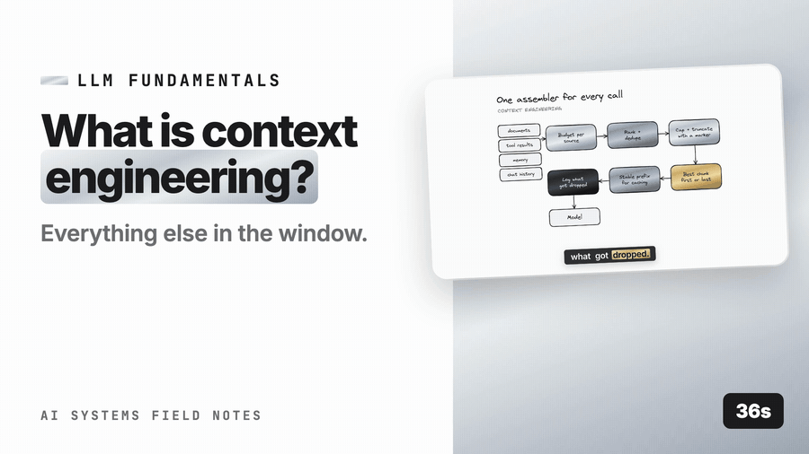

# Context engineering → What it is (managing everything in the window)



*([full-resolution MP4 with audio](demo/what-is-context-engineering-demo.mp4) — 36s · [watch on YouTube](https://youtu.be/UUH0-4K57Es))*

## What it is

The context window is a finite, expensive, attention-limited resource. What goes into it on each call is a design decision with its own component — the **context assembler** — sitting between retrieval/tools/memory and the model:

```
                 ┌─ retrieved chunks (RAG)        ─┐
                 ├─ tool results (agents)          │
inputs ─────────►├─ memory (episodic/semantic)     ├──► context assembler ──► prompt ──► LLM
                 ├─ conversation history           │        │
                 └─ system prompt + examples       ─┘        │ budgets, ordering, dedupe,
                                                             │ truncation, compaction,
                                                             │ isolation, caching
```

Responsibilities:
- **Budgeting**: total window budget split per source ([per-source truncation budgets](per_source_truncation_budgets.md)); nothing overflows; cost is bounded.
- **Selection**: which chunks/memories/tool results make it in (rerank, dedupe, threshold).
- **Ordering**: most relevant first or last, not buried (["Lost in the middle"](lost_in_the_middle.md)).
- **Compaction**: summarise long history; keep the last N turns verbatim ([compaction / summarisation of long history](compaction_summarization.md)).
- **Isolation**: subagents get their own window ([context isolation](context_isolation.md)).
- **Caching**: stable prefix unchanged ([prompt caching of static prefixes](prompt_caching.md)).
- **Hygiene**: delimiters, provenance, truncation markers ([delimiters: instructions vs data](../1-prompt-engineering/delimiters_data_vs_instructions.md)); remove poison ([failure modes: poisoning, distraction, confusion, clash](context_failure_modes.md)).

It is where most "the model is dumb" complaints are actually "the model was given a mess".

## How to implement

1. **One assembler function** for every LLM call: `assemble(system, sources: list[Source], history, user_turn, budget) → messages, meta`. Sources carry `(kind, items, priority, per_item_cap, total_cap)`.
2. **Token-count everything** with the model's tokenizer; never estimate by characters at the budget boundary.
3. **Selection pipeline per source**: rank → dedupe → threshold → cap count → cap tokens per item → cap total.
4. **Global fit**: if the sum exceeds the budget, trim by priority (history summary first, then low-ranked chunks, never the user turn or the top chunk).
5. **Order**: system → examples → tool defs → [context: top chunk first, rest by rank, or top last] → memory → history summary → last N turns → user turn → restated key rule.
6. **Emit metadata**: which items were included/dropped/truncated, token counts per source, cache breakpoints — logged per call ([observability & tracing](../../../10-production/apply/4-observability-reliability/observability_tracing.md)).
7. **Evaluate assembly choices** on the golden set like any other component ([component vs end-to-end](../../../09-evaluation/apply/component_vs_end_to_end.md)): budget sizes, ordering, N verbatim turns.

## Small example

```python
from dataclasses import dataclass, field
import tiktoken
enc = tiktoken.get_encoding("cl100k_base"); T = lambda s: len(enc.encode(s))

@dataclass
class Source:
    kind: str; items: list[dict]; priority: int; item_cap: int; total_cap: int
    included: list = field(default_factory=list); dropped: int = 0; truncated: int = 0

def fit_source(src: Source):
    used = 0
    for it in src.items:                                    # already ranked/deduped/thresholded
        txt = it["text"]
        if T(txt) > src.item_cap:
            txt = enc.decode(enc.encode(txt)[: src.item_cap]) + " …[truncated]"; src.truncated += 1
        if used + T(txt) > src.total_cap:
            src.dropped += 1; continue
        src.included.append(it | {"text": txt}); used += T(txt)
    return used

def assemble(system: str, sources: list[Source], history_summary: str, last_turns: list[str], user: str, budget: int):
    fixed = T(system) + T(user) + T(history_summary) + sum(map(T, last_turns))
    remaining = budget - fixed
    for s in sorted(sources, key=lambda s: -s.priority):    # high priority fits first
        s.total_cap = min(s.total_cap, max(remaining, 0)); remaining -= fit_source(s)
    ctx = "\n".join(render(s) for s in sources)             # delimited blocks (delimiters: instructions vs data)
    body = f"{ctx}\n<history_summary>{history_summary}</history_summary>\n" + "\n".join(last_turns) + f"\n<question>{user}</question>\nRemember: answer only from <context>; cite ids."
    meta = {s.kind: {"included": len(s.included), "dropped": s.dropped, "truncated": s.truncated} for s in sources}
    return {"system": system, "user": body}, meta
```

## Pros

- **Predictable cost and latency**: budgets are enforced, not hoped for.
- **Better answers**: less noise, better position, no starvation of the important source.
- **Debuggable**: per-call metadata shows what the model saw and what was dropped.
- **Reusable** across RAG and agent calls.

## Cons

- **Another component** to design, test, and evaluate.
- **Budget tuning is empirical** and model-specific.
- Aggressive trimming can drop the one chunk that mattered — selection quality (rerank) matters more once budgets are tight.
- Tokenizing everything on every call is a small CPU cost.

## When to use

Every system with more than a trivial prompt — i.e. any RAG or agent system. The moment you have two sources competing for the window, you need an assembler.

## When NOT to use (full machinery)

- Single-source, short-context calls (a classifier on one ticket) — a budget check suffices.

## Production at scale

**Budgets per call site and per tier.** The fast tier gets a small window (cost/latency); the reasoning tier gets more. Store budgets in config with the prompt version ([prompt versioning & evaluation](../1-prompt-engineering/prompt_versioning_evaluation.md)).

**Priority is policy.** Typically: user turn > top-1 chunk > tool result the user asked for > other chunks > memory > history summary > older turns. Make it explicit and per call site.

**Dropped-item telemetry is the most useful metric here.** If the top-ranked chunk is being truncated or the memory source is always dropped, the budget split is wrong. Dashboards per source per call site.

**Long-context models don't remove the need.** Bigger windows cost more per call, degrade attention in the middle (["Lost in the middle"](lost_in_the_middle.md)), and raise latency. Retrieval + assembly with a moderate budget beats stuffing 150k tokens almost always; measure it.

**Agents**: assemble per step; tool results get per-tool caps ([per-source truncation budgets](per_source_truncation_budgets.md)) and are compacted when the step count grows ([compaction / summarisation of long history](compaction_summarization.md)); subagents isolate ([context isolation](context_isolation.md)).

**Caching interplay**: the assembler must keep the stable prefix identical and place cache breakpoints (system / tenant / tools) deliberately ([prompt caching of static prefixes](prompt_caching.md)).

**Failure mode monitoring**: track context poisoning/distraction/confusion/clash signals ([failure modes: poisoning, distraction, confusion, clash](context_failure_modes.md)) — e.g. faithfulness-check failures correlated with number of included chunks.

**Evals**: budget size, ordering strategy, and N verbatim turns are hyperparameters; sweep them on the golden set and multi-turn evals; changes are versioned.

## Prod checklist

- [ ] Single assembler with typed sources, priorities, per-item and per-source caps
- [ ] Token counting with the model's tokenizer
- [ ] Rank → dedupe → threshold → cap pipeline per source
- [ ] Explicit ordering policy; key rule restated at end
- [ ] Included/dropped/truncated metadata logged per call; dashboards per source
- [ ] Budgets per call site/tier in versioned config
- [ ] Stable prefix and cache breakpoints preserved
- [ ] Assembly hyperparameters evaluated on golden + multi-turn sets

## Metrics to watch

| Metric | Why |
|---|---|
| Tokens per source per call (p50/p95) | Budget health |
| Top-chunk truncation/drop rate | Misallocated budget |
| Faithfulness vs number of included chunks | Distraction signal |
| Cost per call vs budget | Enforcement |

## Related

- [Context engineering](../../../AI_System.md#context-engineering) — the tactics
- [Prompt structure](../1-prompt-engineering/prompt_structure.md), [Delimiters](../1-prompt-engineering/delimiters_data_vs_instructions.md)
- [Reranking](../../../06-rag/apply/6-retrieval-ranking/reranking.md) — selection quality
- [Parent–child](../../../06-rag/apply/2-chunking/parent_child_small_to_big.md) Parent–child — what enters as "chunks"
- [Observability](../../../10-production/apply/4-observability-reliability/observability_tracing.md)
