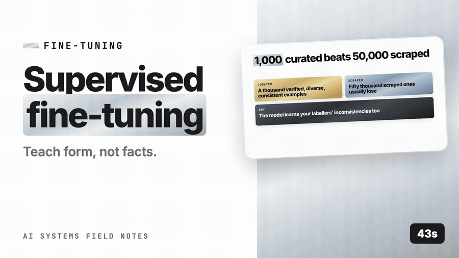

# Fine-tuning → SFT (supervised fine-tuning)



*([full-resolution MP4 with audio](demo/sft-demo.mp4) — 45s · [watch on YouTube](https://youtu.be/16yZV-Tmmy8))*

## What it is

SFT continues training a base model on your own (prompt, completion) pairs so the behaviour you want becomes the default rather than something you request in a long prompt. It teaches **form, style, and procedure** — not facts ([prompting vs RAG vs fine-tuning](../prompting_vs_rag_vs_finetuning.md)).

What SFT is good at:

| Goal | Example |
|---|---|
| House format, reliably | Every clinical note in the exact SOAP structure with your section names |
| Domain phrasing and conventions | Legal summaries in your firm's register; error messages in your product's voice |
| Task-specific extraction | Fields from your particular document types, with your edge-case rules |
| Shorter prompts | Move 3k tokens of format rules into weights ([cost levers](../../../10-production/apply/1-serving-cost-latency/cost_levers.md)) |
| Small-model capability | A 8B model doing a narrow task as well as a frontier model ([distillation](distillation.md)) |

What it is not good at: knowledge that changes (use RAG), tasks that aren't stable yet (you'll retrain constantly), and anything a better prompt fixes ([when *not* to fine-tune](when_not_to_fine_tune.md)).

**Data quality dominates.** Published results and practitioner experience converge: ~1,000 carefully curated, diverse, correct examples typically outperform tens of thousands of noisy ones. The failure mode of SFT is learning your labellers' inconsistencies.

## How to implement

1. **Confirm the task is stable and prompting has hit a ceiling** ([when *not* to fine-tune](when_not_to_fine_tune.md)) — measured, not assumed.
2. **Collect candidate pairs** from: golden set answers ([golden dataset first](../../../09-evaluation/apply/golden_dataset.md)), production outputs that humans accepted or lightly edited ([online eval](../../../09-evaluation/apply/online_eval.md)), and expert-written examples for edge cases.
3. **Curate hard**: deduplicate, remove contradictions, verify correctness, ensure diversity across input types and edge cases, and enforce a single consistent output format.
4. **Hold out a test split by input**, from day one, never used during iteration ([golden dataset first](../../../09-evaluation/apply/golden_dataset.md)).
5. **Match the serving format exactly**: the same system prompt, the same message structure, the same tool schema. A mismatch between training and inference format is the most common cause of disappointing results.
6. **Train**: usually LoRA rather than full fine-tuning ([PEFT / LoRA / QLoRA](peft_lora_qlora.md)); 2–4 epochs; monitor validation loss for overfitting.
7. **Evaluate on the same suite as prompts** ([prompt evaluation](../../../09-evaluation/apply/prompt_evaluation.md)), including behaviour and safety cases — fine-tuning can erode refusal behaviour.

## Small example

```python
import json, random
from collections import Counter

# ---- 1. Build and curate the dataset ----
def build_sft_dataset(sources) -> list[dict]:
    """Each example must match the SERVING format exactly."""
    examples = []
    for s in sources:
        examples.append({
            "messages": [
                {"role": "system", "content": SERVING_SYSTEM_PROMPT},        # identical to production
                {"role": "user", "content": s["input"]},
                {"role": "assistant", "content": s["ideal_output"]},
            ],
            "meta": {"source": s["origin"], "doc_type": s["doc_type"], "reviewed_by": s["reviewer"]},
        })
    return examples

def curate(examples: list[dict], min_examples=500) -> dict:
    seen, kept, dropped = set(), [], Counter()
    for ex in examples:
        key = hashlib.sha256(ex["messages"][1]["content"].encode()).hexdigest()
        if key in seen:                       dropped["duplicate"] += 1; continue
        if not validates_format(ex["messages"][-1]["content"]):
                                              dropped["bad_format"] += 1; continue
        if ex["meta"].get("reviewed_by") is None:
                                              dropped["unreviewed"] += 1; continue
        if len(ex["messages"][-1]["content"]) < 20:
                                              dropped["too_short"] += 1; continue
        seen.add(key); kept.append(ex)

    coverage = Counter(e["meta"]["doc_type"] for e in kept)                  # diversity check
    assert len(kept) >= min_examples, f"only {len(kept)} usable examples"
    assert min(coverage.values()) >= 20, f"thin coverage: {coverage}"
    return {"examples": kept, "dropped": dict(dropped), "coverage": dict(coverage)}

def split_by_input(examples, test_frac=0.15, seed=42):
    """Split by input hash so near-duplicates cannot straddle the split."""
    rnd = random.Random(seed)
    buckets = {}
    for ex in examples:
        k = normalise(ex["messages"][1]["content"])[:200]
        buckets.setdefault(k, []).append(ex)
    keys = list(buckets); rnd.shuffle(keys)
    cut = int(len(keys) * (1 - test_frac))
    train = [e for k in keys[:cut] for e in buckets[k]]
    test  = [e for k in keys[cut:] for e in buckets[k]]
    return train, test

# ---- 2. Train (LoRA; see PEFT / LoRA / QLoRA) ----
"""
from peft import LoraConfig
from trl import SFTTrainer, SFTConfig

cfg = SFTConfig(output_dir="out/soap-notes-v1", num_train_epochs=3,
                per_device_train_batch_size=4, gradient_accumulation_steps=4,
                learning_rate=1e-4, warmup_ratio=0.03, logging_steps=10,
                eval_strategy="epoch", save_strategy="epoch",
                load_best_model_at_end=True, bf16=True, max_seq_length=4096)
peft = LoraConfig(r=16, lora_alpha=32, lora_dropout=0.05, task_type="CAUSAL_LM",
                  target_modules=["q_proj","k_proj","v_proj","o_proj"])
SFTTrainer(model=base, train_dataset=train_ds, eval_dataset=test_ds,
           peft_config=peft, args=cfg).train()
"""

# ---- 3. Evaluate against the SAME suite used for prompts ----
def evaluate_sft(base_model, tuned_model, golden_cases, safety_cases):
    base = run_golden(golden_cases, system_with(base_model), judge)
    tuned = run_golden(golden_cases, system_with(tuned_model), judge)
    safety_base = run_golden(safety_cases, system_with(base_model), judge)
    safety_tuned = run_golden(safety_cases, system_with(tuned_model), judge)
    return {
        "quality_delta": tuned["overall"]["judge_mean"] - base["overall"]["judge_mean"],
        "format_violations": {"base": base["overall"]["format_violation_rate"],
                              "tuned": tuned["overall"]["format_violation_rate"]},
        "prompt_tokens": {"base": base_prompt_tokens, "tuned": tuned_prompt_tokens},   # the cost win
        "safety_regression": safety_base["overall"]["behaviour_correct"]
                             - safety_tuned["overall"]["behaviour_correct"],           # must be ~0
        "verdict": "ship" if tuned["overall"]["judge_mean"] >= base["overall"]["judge_mean"]
                             and safety_tuned["overall"]["behaviour_correct"] >= safety_base["overall"]["behaviour_correct"] - 0.01
                   else "reject",
    }
```

## Pros

- **Consistent format and style** at a rate prompting cannot reach — format-violation rates often drop from several percent to near zero.
- **Shorter prompts**: rules move into weights, cutting per-call input tokens and latency ([cost levers](../../../10-production/apply/1-serving-cost-latency/cost_levers.md)).
- **Enables small models** on narrow tasks, which is the main path to cheap, fast inference ([distillation](distillation.md)).
- **Encodes conventions prompting can't express** — subtle domain register, edge-case handling patterns.
- Cheap with LoRA: hours on a single GPU for typical dataset sizes ([PEFT / LoRA / QLoRA](peft_lora_qlora.md)).

## Cons

- **Data curation is the bulk of the work** and is unglamorous: dedupe, verify, diversify, standardise.
- **Locked to a base model version**: base deprecation means retraining ([fine-tuning ops](fine_tuning_ops.md)).
- **Can erode general capability and safety behaviour** (catastrophic forgetting), including refusals — must be evaluated explicitly.
- **Evaluation gets harder**, not easier: you now have model *and* prompt versions interacting ([when *not* to fine-tune](when_not_to_fine_tune.md)).
- **Retraining cadence** as the task evolves; each cycle is dataset work plus training plus evaluation.
- Inconsistent labels teach inconsistency — the model reproduces your labellers' disagreements.

## When to use

- The task is **stable**, high-volume, and format- or style-critical.
- Prompting works but doesn't scale: the prompt is long, brittle, and still produces format violations.
- You want a smaller/cheaper model to match a larger one on a narrow task ([distillation](distillation.md)).
- You have (or can create) several hundred verified, consistent examples.

## When NOT to use

- For **knowledge** — it goes stale, can't be cited, can't be deleted for GDPR, and doesn't stop hallucination ([prompting vs RAG vs fine-tuning](../prompting_vs_rag_vs_finetuning.md)).
- Before the task is stable — you'll retrain every sprint.
- When a better prompt or better retrieval fixes it ([when *not* to fine-tune](when_not_to_fine_tune.md)).
- Without an eval suite — you'd be unable to tell whether it helped.

## Production at scale

**Curate ruthlessly; quantity is the lesser variable.** A thousand verified, diverse, consistently formatted examples typically beat tens of thousands of scraped ones. Budget most of the project for data work, not training.

**Training format must equal serving format, exactly.** Same system prompt, same message roles, same tool schema, same delimiters. Mismatch here is the single most common reason a fine-tune underperforms in production.

**Mine production for examples** ([data flywheel](../../../10-production/apply/8-data-flywheel/data_flywheel.md)): outputs a human accepted unchanged, or edited only lightly, are your highest-quality supervision — with edit distance as an implicit quality signal ([online eval](../../../09-evaluation/apply/online_eval.md)).

**Hold out by input, not by row**, so near-duplicates don't straddle the split and inflate your test score.

**Evaluate safety and refusal behaviour explicitly.** Fine-tuning on task data can weaken abstention and guardrail behaviour; include the unanswerable and adversarial cases in the eval and gate on them ([golden dataset first](../../../09-evaluation/apply/golden_dataset.md), [the testing pyramid](../../../09-evaluation/apply/testing_pyramid.md)).

**Keep RAG for facts.** The production pattern is fine-tuned model for form plus retrieval for content plus a short prompt for the task — each layer doing what it's good at ([prompting vs RAG vs fine-tuning](../prompting_vs_rag_vs_finetuning.md)).

**Version datasets alongside checkpoints** ([fine-tuning ops](fine_tuning_ops.md)): a model artifact without its exact training dataset hash is unreproducible.

**Measure the cost win**: shorter prompts and a smaller model should show up in $/request ([cost levers](../../../10-production/apply/1-serving-cost-latency/cost_levers.md)). If a fine-tune improves quality but costs more to serve, the case is weaker than it looks.

## Prod checklist

- [ ] Task stability and prompting ceiling demonstrated with eval data before starting
- [ ] Examples curated: deduplicated, verified, diverse, single consistent output format
- [ ] Training format byte-identical to serving format (system prompt, roles, schemas)
- [ ] Held-out test split by input hash, untouched during iteration
- [ ] Production-accepted outputs mined as training data with quality signals
- [ ] Evaluation on the same suite as prompts, including safety and abstention cases
- [ ] Base-model version pinned; retraining plan for deprecation
- [ ] Dataset versioned with the checkpoint; training config and seed recorded
- [ ] Serving cost measured before/after (prompt tokens, model size)

## Metrics to watch

| Metric | Why |
|---|---|
| Format-violation rate, base vs tuned | The main reason to do this |
| Task quality on held-out set | The gain |
| Safety/abstention behaviour delta | Catastrophic-forgetting check |
| Prompt tokens per request, before/after | The cost win |
| Training examples by category | Coverage and thin spots |

## Related

- [Prompting vs RAG vs fine-tuning](../prompting_vs_rag_vs_finetuning.md) — the decision
- [LoRA/QLoRA](peft_lora_qlora.md) — how to train it cheaply
- [Distillation](distillation.md), [When not to](when_not_to_fine_tune.md), [Ops](fine_tuning_ops.md)
- [Golden dataset first](../../../09-evaluation/apply/golden_dataset.md) / [prompt evaluation](../../../09-evaluation/apply/prompt_evaluation.md) — the eval suite it must pass
- [Data flywheel](../../../10-production/apply/8-data-flywheel/data_flywheel.md) — where the examples come from
